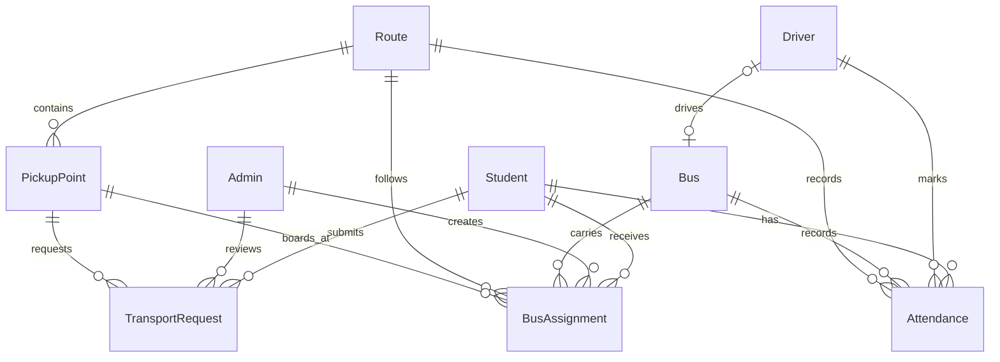

# Database relationships and upgrade notes

The application registers exactly nine Mongoose models. Account identity and authentication live directly in Student, Driver and Admin; there is no shared authentication entity or separate pass entity.

Administrators manage Student and Driver profiles, buses, routes and pickup points through protected APIs. Management permissions do not require redundant foreign keys on every entity.

## Field decisions

| Model | Identity and relationships |
| --- | --- |
| Student | `name`, unique `studentId` (enrollment number), unique `collegeEmail`, `phone`, `department`, optional `semester`, hashed `password`, `isVerified`, `transportStatus` |
| Driver | generated unique `driverId`, `name`, unique `email`, `phone`, unique `licenseNumber`, hashed `password`, `isVerified`, `status`, `assignedBus`, `assignedRoute` |
| Admin | generated unique `adminId`, `name`, unique `email`, optional `phone`, `department`, hashed `password` |
| Bus | unique `busNumber`, unique `registrationNumber`, integer `capacity`, `busType`, `status`, `assignedDriver`, internal `assignmentSequence` |
| Route | `routeName`, unique `routeCode`, `startPoint`, `endPoint`, `description`, `timings`, `pickupPoints`, `assignedBus`, `assignedDriver`, `status` |
| PickupPoint | `name`, `location`, `landmark`, `route`, integer `sequence`, optional `pickupTime` (HH:MM), `status` |
| TransportRequest | `student`, `pickupPoint`, `requestedRoute`, `requestDate`, `status`, `reviewedBy`, `reviewedAt`, `rejectionReason` |
| BusAssignment | `student`, `bus`, `route`, `pickupPoint`, unique `busPassId`, `assignedBy`, `assignedAt`, `status` |
| Attendance | `student`, `driver`, `bus`, `route`, `pickupPoint`, `busPassId`, `date`, `status`, `boardingTime`, `markedAt` |

Existing names such as `studentId`, `location`, `requestDate` and `transportStatus` are retained. All models include timestamps. Student assignment details come from BusAssignment, avoiding competing copies on the Student document.

## Invariants

- Emails are normalized within each account collection; enrollment and license identifiers are unique. The same email can identify different roles, so login requires an explicit role.
- Public registration permits only student and driver. Admins are provisioned explicitly.
- Passwords use bcrypt and are never returned, including through populated relationships. Registration passwords require 8 characters and at most 72 UTF-8 bytes.
- A partial unique index permits at most one pending or approved request per student. A rejected request may be followed by a new request.
- A partial unique index permits at most one active assignment per student. Pass IDs remain unique and permanent.
- Assignment requires an approved request for that pickup/route, an active bus, matching route and available capacity. Transactional bus sequence increments serialize concurrent capacity checks and generate IDs without a tenth counter model.
- Driver, Bus and Route references are updated together in a transaction. Conflicting existing assignments are rejected.
- Attendance is unique per student per date, regardless of bus or route. `date` represents a campus calendar day; the API uses Asia/Kolkata and normalizes storage to UTC midnight. Drivers cannot backdate or submit attendance for another driver's assignment.
- Referenced transport records cannot be deleted through CRUD endpoints; mark them inactive where appropriate to preserve history.
- MongoDB Atlas or a replica set is required for transactions.

## Existing-installation upgrade checklist

No production migration or data deletion runs automatically. The application no longer reads retired collections. Test cleanup is limited to newly created databases with guarded names.

Before deploying to an existing database:

1. Back up the database and rehearse the upgrade on a copy. Stop writes during the final cutover.
2. Consolidate each existing account's name, login address and bcrypt hash into its Student, Driver or Admin document. Preserve profile `_id` values so requests, assignments and attendance keep their relationships. Resolve missing profiles and duplicate emails/enrollment/license values before enforcing uniqueness. Never rehash an existing bcrypt hash or import it as a new plain-text password.
3. Existing profiles require their role's email and password fields to sign in. Complete required profile details. Explicitly provision missing administrator accounts with the provided seed script.
4. Review legacy authentication-only foreign-key fields and their indexes. Remove obsolete uniqueness constraints after migration; an old unique index on a removed field can block new registrations. Also retire the former Student pass-ID index after moving assignment data to BusAssignment. Do not run an automatic `syncIndexes()` against production without reviewing its proposed index removals.
5. Consolidate any duplicated Student assignment values into BusAssignment. Preserve permanent pass IDs. Resolve multiple active assignments and duplicate open requests before creating the new partial unique indexes.
6. Backfill Bus.assignedDriver from the existing driver/bus relationship, reconcile Route/Driver references, and initialize each bus's `assignmentSequence` to at least its highest existing generated pass suffix. Do not transfer assignments during migration.
7. Map existing attendance `markedBy` references to `driver`, preserve Driver IDs, and normalize legacy dates using the campus calendar day. Resolve duplicate student/day rows before building the new `{ student, date }` unique index; review the superseded compound index separately.
8. Validate all references, reconcile Route.pickupPoints and PickupPoint.route, then apply the reviewed indexes. Expect prior sessions to require a fresh login because new JWTs contain the role.
9. Run the regression suite and sample existing accounts on the copy, then perform the reviewed production cutover. Retire obsolete collections only under a separate explicit data-retention decision.

The code update does not silently migrate or erase existing account data. This checklist is required for an existing installation with legacy records or indexes.
